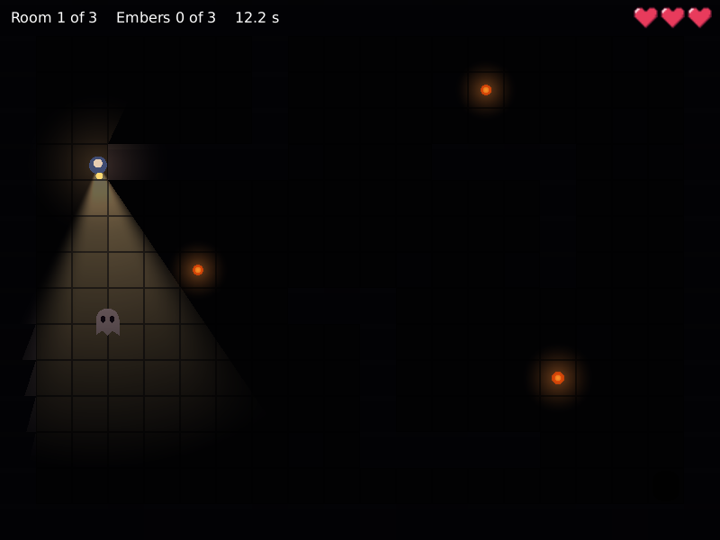

# Smitten

A 2D game framework for Rust.

You write `load`, `update` and `draw`, and call modules such as `graphics`,
`audio` and `keyboard` from anywhere. Smitten is built on SDL3 and its GPU
API.

**[Read the guide](https://charlesbthomas.github.io/smitten/)** ·
[Examples](https://charlesbthomas.github.io/smitten/examples/) ·
[API reference](https://charlesbthomas.github.io/smitten/api/smitten/) ·
[Coming from LÖVE](https://charlesbthomas.github.io/smitten/guide/coming-from-love/)



```rust
use smitten::{graphics, Color, Config, Game};

struct Hello;

impl Game for Hello {
    fn load() -> smitten::Result<Self> {
        Ok(Hello)
    }

    fn draw(&mut self) {
        graphics::clear(Color::rgb(0.1, 0.1, 0.2));
        graphics::print("Hello from smitten", (40.0, 40.0));
    }
}

fn main() {
    smitten::run::<Hello>(Config::default());
}
```

## Features

- **Everything a 2D game needs**: graphics, audio, input, physics, files,
  video and the rest, in one crate with one consistent API.
- **Graphics:** shapes, images, text, canvases, WGSL shaders, the stencil,
  sprite batches, particles, meshes and automatic batching.
- **Audio:** WAV, Ogg Vorbis, MP3 and FLAC, static or streamed, positional,
  with filters and effects.
- **Physics** on [Rapier](https://rapier.rs), with worlds, bodies,
  fixtures and joints.
- **High-DPI and fixed design sizes**, including pixel-perfect scaling for
  pixel art.
- **A blue error screen** instead of a vanishing window when a game panics,
  and **hot reload** of images, shaders, fonts and sounds while it runs.
- **`cargo smitten package`**, which builds a release with SDL linked in and
  zips it with the game's assets, or makes a `.app` with an icon on macOS.
  The assets can be filtered with include and exclude patterns, or built
  into the executable.

Smitten runs on Windows, Linux and macOS. Rendering uses SDL's GPU API:
Vulkan on Windows and Linux, and Metal on macOS, with your WGSL shaders
translated for each.

## Quick start

SDL3 is built from source on the first build, which needs CMake and a C
compiler. [just](https://github.com/casey/just) 1.44 or newer installs
everything, including Rust:

```sh
git clone https://github.com/charlesbthomas/smitten
cd smitten
just setup
just run lantern
```

To use Smitten in your own game, add it from Git. It isn't on crates.io yet:

```toml
[dependencies]
smitten = { git = "https://github.com/charlesbthomas/smitten" }
```

Put images, sounds and fonts in an `assets` folder next to your
`Cargo.toml`. [Getting started](https://charlesbthomas.github.io/smitten/guide/getting-started/)
goes through it step by step, including installing the tools by hand.

## Examples

`cargo run --example <name>` (or `just run <name>`) runs one from the
workspace root. There are five small games, `lantern`, `pong`, `topple`,
`undercroft` and `shardfall`, and a demo of each part of the framework:
`hello`, `sprites`, `shapes`, `text`, `input`, `audio`, `spatial_audio`,
`canvas`, `shader`, `stencil`, `particles`, `mesh`, `physics`, `lighting`,
`design`, `graphics_extras`, `video`, `rumble`, and `benchmark` (run it
with `--release`). The
[examples page](https://charlesbthomas.github.io/smitten/examples/) has
screenshots.

## Workspace

Games depend only on `smitten`.

| Crate | Purpose |
| --- | --- |
| `crates/smitten` | The public API: the `Game` trait, `run`, and the framework modules. |
| `crates/smitten-core` | Shared types (`Color`, `Key`, `Config`) and the `Backend` trait that platforms implement. No dependencies. |
| `crates/smitten-sdl` | The SDL3 backend. The only crate with `unsafe` code or a native library. |
| `crates/examples` | The example games and the assets they load. |
| `crates/cargo-smitten` | The `cargo smitten package` command. |
| `site` | The documentation site, built with [Zola](https://www.getzola.org). |

## Development

| Command | What it does |
| --- | --- |
| `just setup` | Installs Rust, CMake, a C compiler and SDL's build dependencies. |
| `just run <example>` | Runs an example. |
| `just docs` | Builds the documentation site and API reference into `site/public`. Needs Zola and Python. |
| `just docs-serve` | Builds the site and serves it at http://127.0.0.1:1111. |

CI runs `cargo fmt --all --check`, `cargo clippy --workspace --all-targets -- -D warnings`,
`cargo test --workspace` and `cargo doc` with warnings as errors. On macOS
it also checks every Metal shader translation with Apple's compiler, runs
a few examples on Metal and packages one as an app. The Docs
workflow builds the site on pull requests and publishes it from `main`.

## License

Smitten is under the [zlib license](LICENSE), the same as SDL.
It is not affiliated with or endorsed by the LÖVE project. The built-in
font is Bitstream Vera Sans, under its own
[license](crates/smitten/src/graphics/fonts/LICENSE-Vera.txt).
